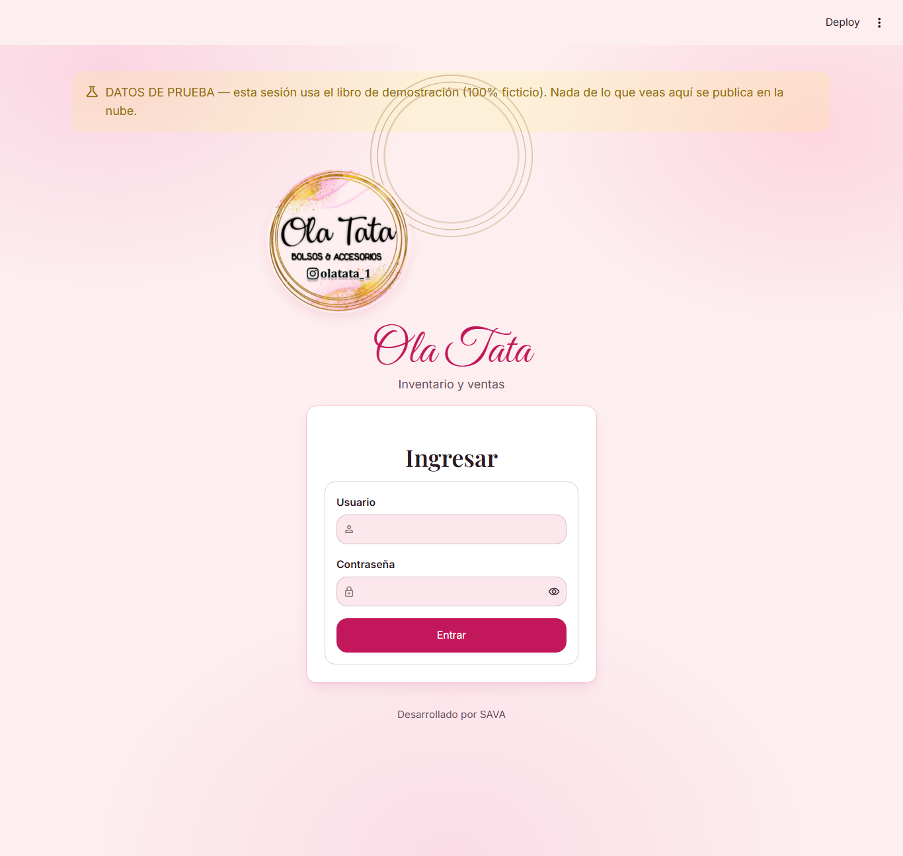
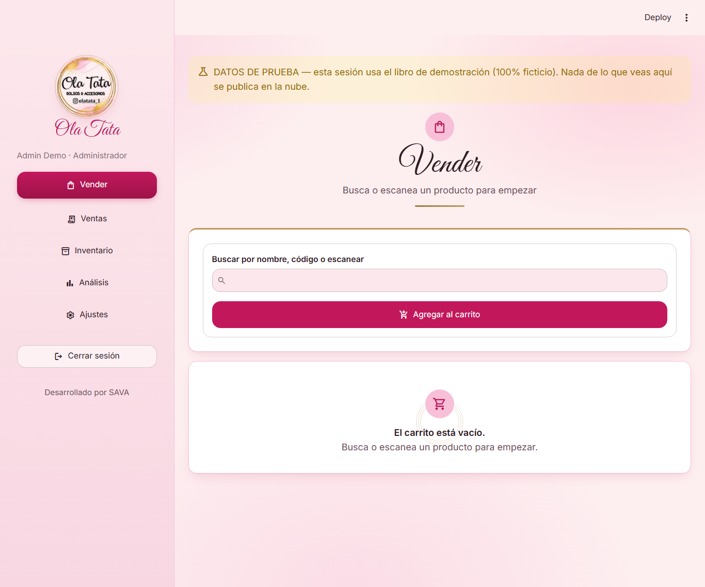
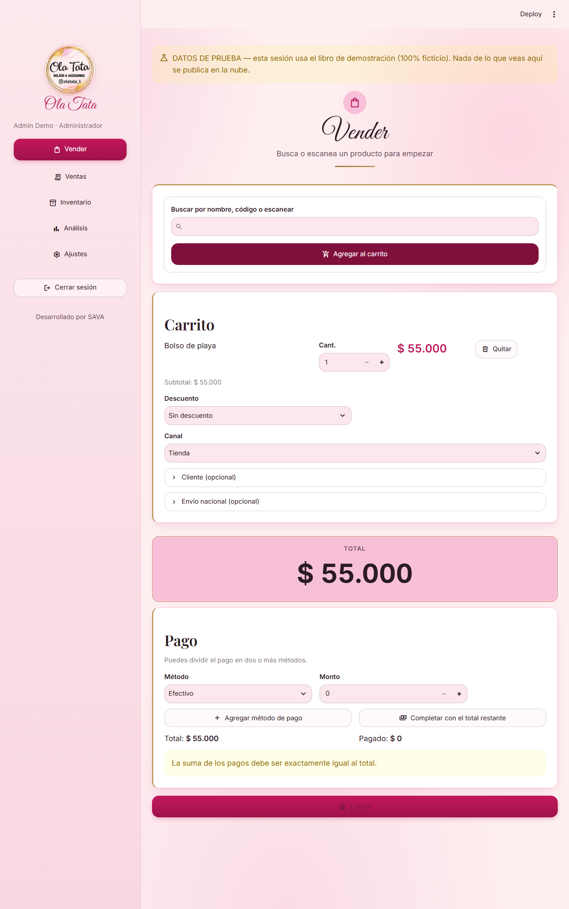
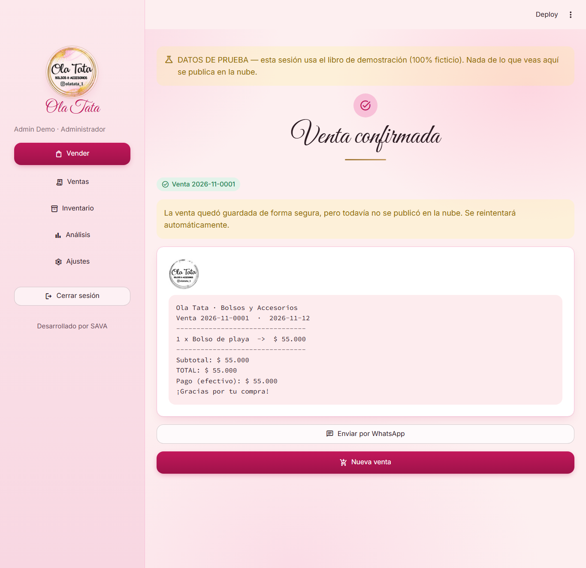
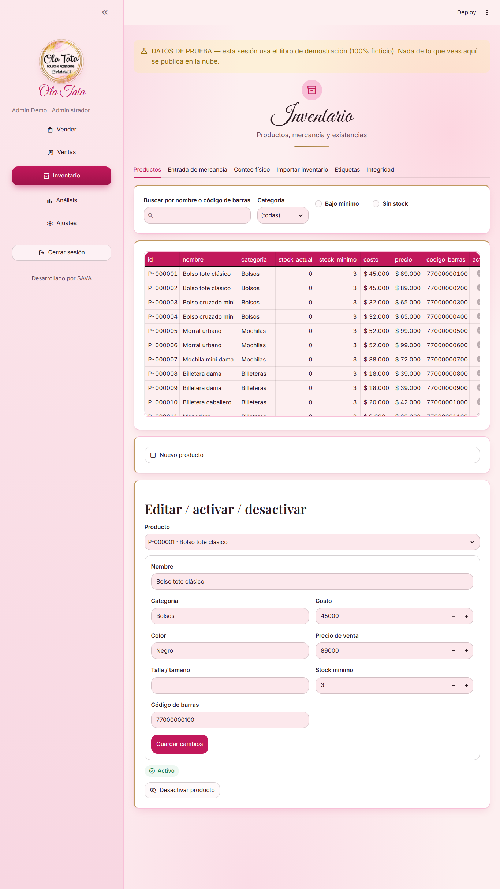
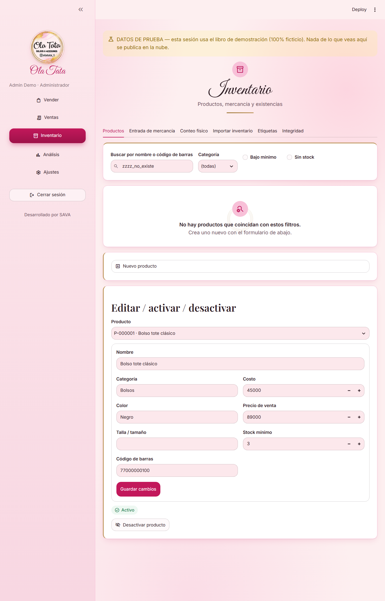
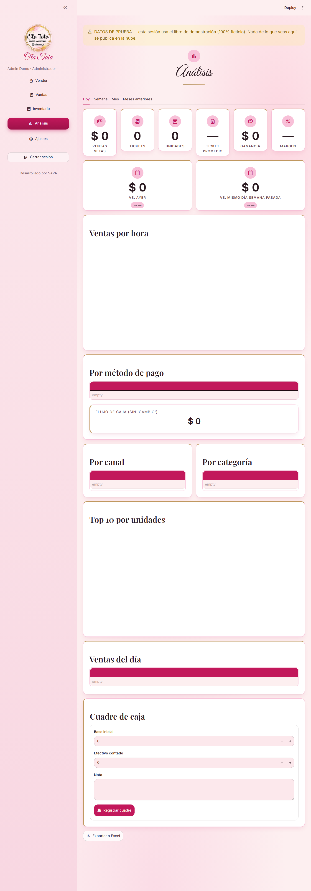
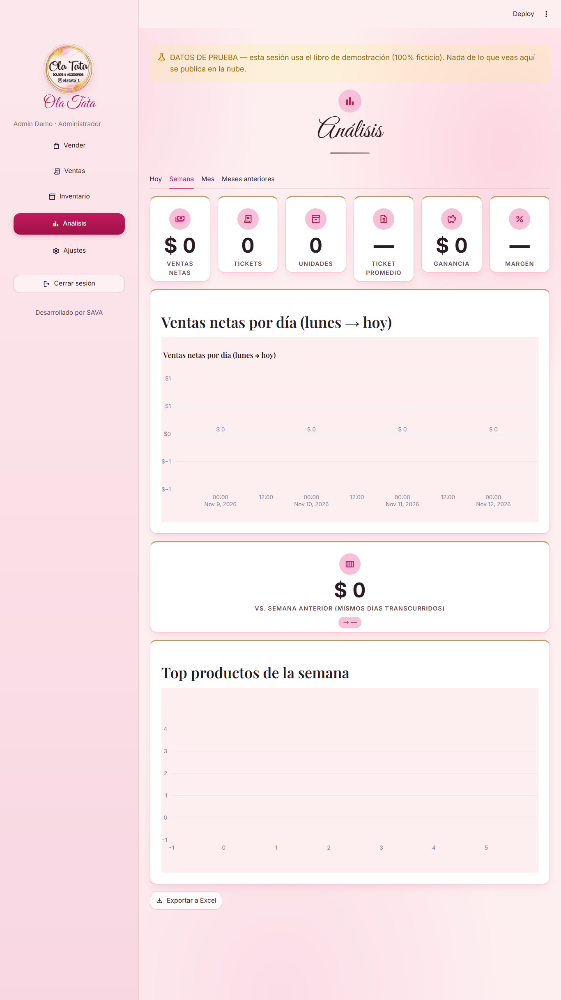
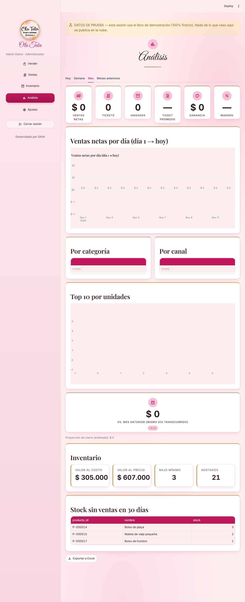
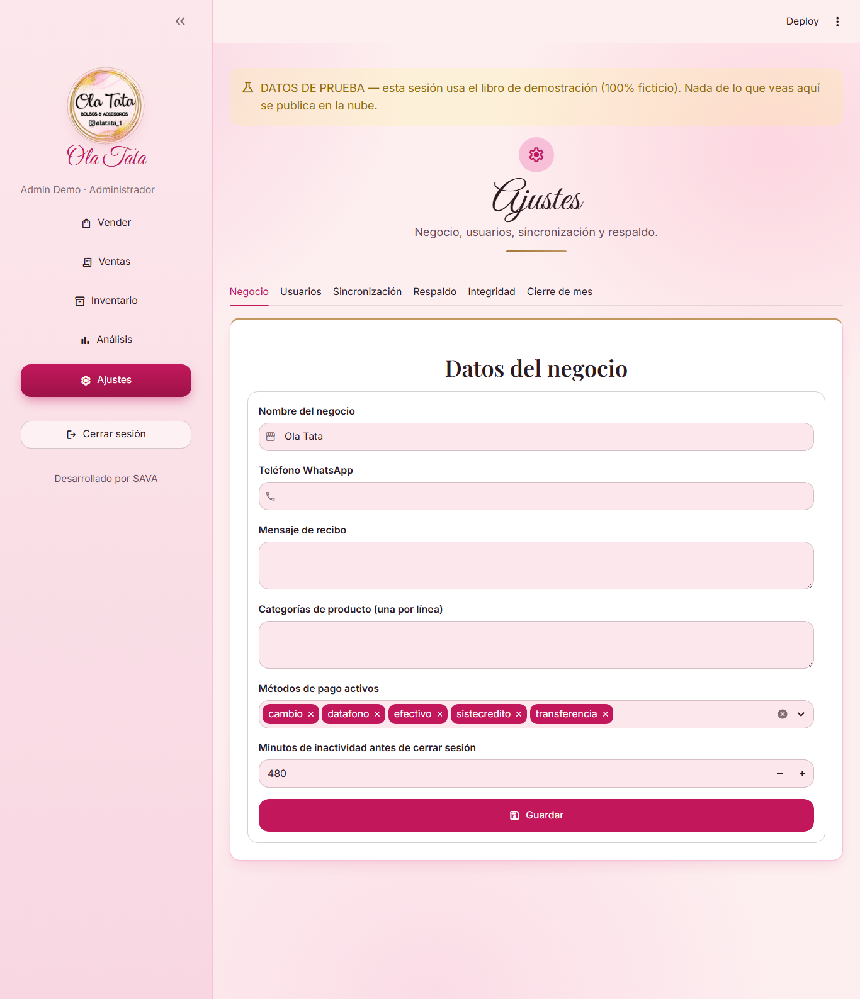

# Manual de usuario — Ola Tata · Inventario y Ventas

Guía corta, en español sencillo, de lo que puede hacer cada rol en la
aplicación.

> **Aviso sobre el modo demo.** Si ves un recuadro amarillo que dice
> **"DATOS DE PRUEBA"** en la parte superior de la pantalla, estás en el
> libro de demostración (`DEMO=1`, ver `README.md`): es 100% ficticio,
> vive en un archivo aparte (`demo/OLATATA_DEMO.xlsx`) y **nunca** se
> publica a GitHub ni toca el libro real del negocio
> (`core/demo_mode.py`, `core/storage.py`). Las capturas de este manual
> se tomaron en modo demo, por eso aparecen productos, clientes y
> ventas de ejemplo.

---

## Dueño/a (rol Administrador)

Como dueño/a tienes acceso a **todas** las pantallas: Vender, Ventas,
Inventario, Análisis y Ajustes.

### Vender

1. Entra a **Vender**.

   
2. Escribe o escanea el nombre, el código o el código de barras del
   producto y presiona Enter (o el botón "Agregar al carrito").
3. Ajusta la cantidad de cada línea del carrito si hace falta, o quítala
   con "Quitar".

   
4. Si aplica, agrega un descuento (porcentaje o monto fijo), elige el
   canal de venta (Tienda, Instagram o WhatsApp), y si el cliente lo
   pide, el nombre/teléfono y los datos de envío nacional (ciudad,
   transportadora, número de guía).
5. En "Pago" elige el método (efectivo, datáfono, transferencia,
   Sistecrédito o cambio/saldo a favor). Puedes dividir el pago entre
   varios métodos con "+ Agregar método de pago"; el botón "Completar
   con el total restante" llena automáticamente lo que falta.
6. "Confirmar venta" solo se habilita cuando lo pagado coincide
   exactamente con el total.
7. Al confirmar, se muestra el recibo en texto y un botón para enviarlo
   por WhatsApp al cliente. "Nueva venta" limpia el carrito para
   empezar otra.

   

### Ver y gestionar ventas

En **Ventas** ves **todas** las ventas de todos los vendedores (filtra
por rango de fechas). Cada venta se puede abrir para ver sus productos.

- **Anular una venta**: solo tú puedes hacerlo. Abre la venta → "Anular
  venta" → escribe el motivo (obligatorio) → "Confirmar anulación". El
  stock de los productos se repone automáticamente. No se puede
  deshacer.
- **Devolución o cambio**: elige el producto devuelto, la cantidad, si
  el producto vuelve a stock o se marca como dañado (merma), el método
  de reembolso y el motivo (obligatorio), luego "Registrar devolución".

### Inventario (solo tú puedes entrar aquí)

Administra productos (crear/editar, costo, precio, stock mínimo,
código de barras), proveedores, entradas de mercancía, conteo físico,
importación masiva desde un archivo y la impresión de etiquetas con
código de barras. Si todavía no hay productos cargados, verás una
pantalla vacía con una guía para empezar:

### Análisis con costos y ganancia

A diferencia de un vendedor, tú ves el análisis **completo**: además de
ventas, unidades y tickets, ves el costo de lo vendido y la ganancia
bruta, con pestañas Hoy / Semana / Mes / Meses anteriores.

### Ajustes (solo tú puedes entrar aquí)

En el menú lateral entra a **Ajustes**. Tiene 6 pestañas:

- **Negocio**: nombre del negocio, teléfono de WhatsApp para recibos,
  mensaje del recibo, categorías de producto y métodos de pago activos,
  y los minutos de inactividad antes de cerrar sesión automáticamente.
- **Usuarios**: crea cuentas nuevas (nombre, usuario, rol
  Administrador/Vendedor y una clave temporal generada o propia — la
  persona debe cambiarla al ingresar por primera vez). También puedes
  activar o desactivar usuarios existentes (hay que escribir el nombre
  de usuario para confirmar).
- **Sincronización**: muestra si hay cambios pendientes de subir a
  GitHub o algún conflicto entre lo guardado en este equipo y lo
  remoto.
- **Respaldo**: descarga el archivo `.xlsx` completo de la base de
  datos tal como está en este momento.
- **Integridad**: verifica que el inventario esté consistente.
- **Cierre de mes**: archiva el mes terminado (ventas, pagos,
  devoluciones, movimientos y cuadre de caja) y deja el inventario
  listo para el mes siguiente. Hay que escribir literalmente
  **CERRAR MES** para habilitar el botón. **No se puede deshacer** y
  **nunca** se puede cerrar el mes en curso.

---

## Vendedor/a

Como vendedor/a ves **Vender**, **Ventas** y una versión reducida de
**Análisis** — no tienes acceso a Inventario ni a Ajustes.

### Vender

Exactamente igual que el proceso del Dueño/a descrito arriba: buscar o
escanear, carrito, descuento, canal, cliente/envío opcional, pago
(puede dividirse en varios métodos) y "Confirmar venta". Al confirmar
obtienes el recibo y el enlace para enviarlo por WhatsApp.

### Ver tus ventas

En **Ventas** solo ves **tus propias** ventas (filtradas por rango de
fechas), no las de otros vendedores ni las del Dueño/a.

- **No puedes anular ventas** — esa opción no aparece en tu pantalla.
- **Sí puedes registrar una devolución o cambio** sobre tus propias
  ventas: mismo formulario que el Dueño/a (producto, cantidad, destino
  del producto, método de reembolso y motivo obligatorio).

### Consultar tu análisis básico (sin costos)

En **Análisis** ves tus propias ventas, unidades vendidas y número de
tickets de Hoy / Semana / Mes — pero **nunca** el costo de los
productos ni la ganancia: esas cifras simplemente no aparecen en tu
pantalla (la pantalla muestra el aviso "Vista de vendedor: ventas,
unidades y tickets de tu turno. Sin costos ni ganancia.").

### Lo que no puedes hacer

- No ves Inventario (productos, proveedores, conteo, importación,
  etiquetas).
- No puedes entrar a Ajustes (ni ver usuarios, ni cerrar el mes, ni
  descargar el respaldo, ni ver costos/ganancia en Análisis). Si lo
  necesitas, pídeselo al Dueño/a.

---

## Capturas de pantalla (modo demo, datos 100% ficticios)

Tomadas con Playwright contra la app real corriendo con `DEMO=1`
(carpeta `docs/capturas/v2/`, 11 pantallas × 3 resoluciones —
`_desktop`, `_fullhd` y `_mobile`; este manual usa las `_desktop`).
Confirman que el sistema de diseño (logo circular sin halo, tipografía
Playfair Display/Inter/Great Vibes autoalojada, paleta de marca,
tarjetas KPI con borde dorado) se ve como se espera.

| # | Pantalla | Archivo (`_desktop`) |
|---|---|---|
| 01 | Login | `docs/capturas/v2/01_login_desktop.png` |
| 02 | Login con error | `docs/capturas/v2/02_login_error_desktop.png` |
| 03 | Vender | `docs/capturas/v2/03_vender_desktop.png` |
| 04 | Vender — carrito con productos | `docs/capturas/v2/04_vender_carrito_desktop.png` |
| 05 | Recibo de venta | `docs/capturas/v2/05_recibo_desktop.png` |
| 06 | Inventario | `docs/capturas/v2/06_inventario_desktop.png` |
| 07 | Inventario vacío (sin productos) | `docs/capturas/v2/07_inventario_vacio_desktop.png` |
| 08 | Análisis — Hoy | `docs/capturas/v2/08_analisis_hoy_desktop.png` |
| 09 | Análisis — Semana | `docs/capturas/v2/09_analisis_semana_desktop.png` |
| 10 | Análisis — Mes | `docs/capturas/v2/10_analisis_mes_desktop.png` |
| 11 | Ajustes | `docs/capturas/v2/11_ajustes_desktop.png` |

Las versiones `_fullhd` (1920x1080) y `_mobile` (390x844) de cada una
de estas 11 pantallas existen en la misma carpeta, por si se necesita
material para otro formato.
